<p align="center">
  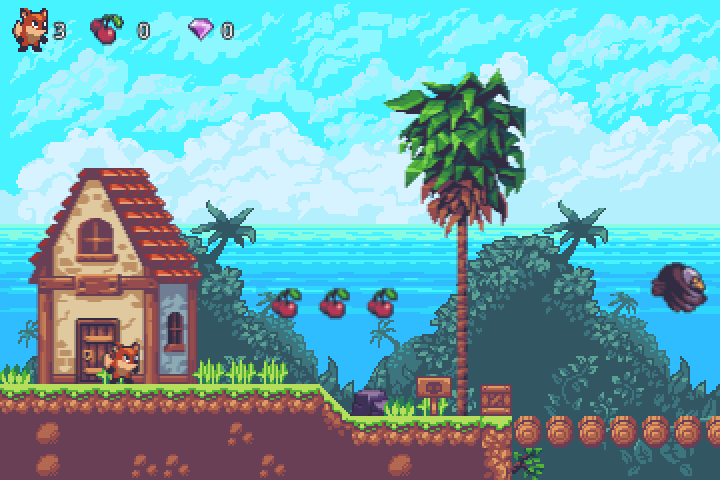
</p>

<h1 align="center">SunnyLand</h1>

<p align="center">
  A small platformer made to be read:<br>
  a first course in the <a href="https://defold.com">Defold</a> engine, one idea at a time.
</p>

---

SunnyLand is one level of a 2D platformer, made with Defold 1.14. A fox runs, jumps,
climbs a ladder, collects cherries and gems, breaks crates, pulls a crank and tries not
to stand under the stone face. All of it is about 1,100 lines of Lua.

The game is the excuse. The point is this page: a course for someone who has never
opened Defold. It goes through the engine one idea at a time and shows each idea in the
place where this game uses it. Every snippet below is from this project, every editor
screenshot is the real Defold editor with this project open, and every picture of the
game was taken from the game running.

| If you | Start at |
|---|---|
| have never programmed | [If you are new to programming](#if-you-are-new-to-programming) |
| program, but have never used Defold | [The course](#the-course) |
| just want to see it move | [Play it first](#play-it-first) |

## Thank you

Nothing you see or hear in this game was made here. It was given away by the people
below, and it never hurts to say thanks.

| | Made by | Licence |
|---|---|---|
| **The art**: the fox, the enemies, the tiles, the backgrounds, the props and the effects | [Sunny Land](https://ansimuz.itch.io/sunny-land-pixel-game-art), by **Ansimuz** (Luis Zuno) | [CC0 1.0](https://creativecommons.org/publicdomain/zero/1.0/), public domain |
| **The music**: `music/walkyandtalky.ogg` | **Pascal Belisle**, as credited by the same pack | Free to use, with credit |
| **The font**: Open Sans SemiBold | The Open Sans Project Authors | [SIL Open Font License 1.1](https://openfontlicense.org/), in `ui/fonts/OFL.txt` |
| **The engine** | The [Defold Foundation](https://defold.com/foundation/) | The [Defold License](https://defold.com/license/), free to use |

**Ansimuz** is Luis Zuno, a pixel artist and independent game developer. Sunny Land is
his free, all-in-one pack for a 2D platformer: animated characters and enemies, items,
props, effects, tile sets and music, "inspired by classics like Sonic and Super Mario"
in the words of its page. He released it under CC0, which means anyone may use it for
anything without asking, and that is the only reason a demo like this one can exist.
The page also states that no generative AI was used to make it.

The pack is pay-what-you-want. If this course is useful to you, its page is where the
thank-you goes:

- [Sunny Land on itch.io](https://ansimuz.itch.io/sunny-land-pixel-game-art), to
  download the pack or pay for it
- [the rest of his work](https://ansimuz.itch.io), which is a lot
- [his Patreon](https://www.patreon.com/ansimuz)

**The music** is the track that ships with the pack's own Godot template. The pack
credits its music to Pascal Belisle
([SoundCloud](https://soundcloud.com/thetoadz), [Patreon](https://www.patreon.com/thetoadz)),
who asks for one thing in return, which is credit. Here it is, gladly.

## Contents

- [Play it first](#play-it-first)
- [If you are new to programming](#if-you-are-new-to-programming)
- [The course](#the-course), for people who program but have never used Defold
  1. [What Defold is](#1-what-defold-is)
  2. [The editor](#2-the-editor)
  3. [A project is a folder of text](#3-a-project-is-a-folder-of-text)
  4. [Game objects, components and collections](#4-game-objects-components-and-collections)
  5. [Scripts](#5-scripts)
  6. [Script properties](#6-script-properties)
  7. [Addresses](#7-addresses)
  8. [Messages](#8-messages)
  9. [Lua modules](#9-lua-modules)
  10. [Sprites, atlases and tile sources](#10-sprites-atlases-and-tile-sources)
  11. [The tile map](#11-the-tile-map)
  12. [Input](#12-input)
  13. [Collision objects](#13-collision-objects)
  14. [Reacting to a collision](#14-reacting-to-a-collision)
  15. [Moving a kinematic body](#15-moving-a-kinematic-body)
  16. [Time](#16-time)
  17. [Factories](#17-factories)
  18. [The camera](#18-the-camera)
  19. [The GUI](#19-the-gui)
  20. [Collection proxies](#20-collection-proxies)
  21. [Sound](#21-sound)
  22. [Finding out what went wrong](#22-finding-out-what-went-wrong)
- [Now change something](#now-change-something)
- [Reference](#reference): where each file is, who says what to whom, the collision groups
- [The smoke test](#the-smoke-test)
- [Gotchas](#gotchas)
- [Keep going](#keep-going)
- [Licence](#licence)

## Play it first

1. Install [Defold](https://defold.com/download/), version 1.14.0 or newer. It is free,
   and it is one download for Windows, macOS or Linux.
2. Get this repository, as a download or with `git clone`.
3. Start Defold, choose **Open From Disk...** and pick the `game.project` file of this
   folder.
4. Choose **Project ▸ Build**, or press `Ctrl+B`. The game starts in its own window.

| To | Keyboard | Gamepad |
|---|---|---|
| Walk | `←` `→` | D-pad or left stick |
| Jump | `Space` or `Enter` | A |
| Climb a ladder, pull the crank | `↑` | Up |
| Crouch, climb down | `↓` | Down |
| Let go of a ladder | Jump | Jump |
| Play again, on the final screen | Jump | Jump |

The keys on this page are those of Windows and Linux. On a Mac, read `Cmd` where it
says `Ctrl`.

The version matters. The camera script calls `camera.*` functions, and with the
settings of this project a game object script only reaches them on Defold 1.14.0 or
newer. On an older editor the game starts, but the camera stays where it was born and
the fox walks out of the picture.

## If you are new to programming

Defold games are written in **Lua**, a small language that was designed to be easy to
read. The course on this page assumes you can already read code: variables, functions,
`if`, loops, and Lua's one data structure, the table. If those words are new, spend a
few evenings with one of the resources below and then come back. All of them are free.

| Resource | What it is | Use it when |
|---|---|---|
| [CS50x](https://cs50.harvard.edu/x/) | Harvard's introduction to programming, complete, with lectures and exercises | You have never written a program. It does not teach Lua, it teaches programming, and that is the hard part |
| [Programming in Lua, first edition](https://www.lua.org/pil/contents.html) | The book on Lua, by the person who designed the language, free to read online | You want to learn Lua properly. Part I is what you need for this course |
| [Learn Lua in Y minutes](https://learnxinyminutes.com/lua/) | The whole language as one page of commented code | You know another language and want Lua in twenty minutes |
| [The Lua demo page](https://www.lua.org/demo.html) | A box where you type Lua and press Run | You want to try a line without installing anything |
| [Exercism's Lua track](https://exercism.org/tracks/lua) | Small exercises, checked automatically, with optional human mentors | Reading is not sticking and you need to practise |
| [Lua in Defold](https://defold.com/manuals/lua/) | Defold's own summary of the Lua it runs | You want a refresher that stops exactly where Defold begins |
| [The Lua 5.1 reference manual](https://www.lua.org/manual/5.1/) | The definition of the language Defold uses | You need to look something up. It is a reference, not a lesson |
| [The lua-users tutorials](http://lua-users.org/wiki/TutorialDirectory) | A wiki of short tutorials, one subject each | You are stuck on one specific subject, such as strings or scope |
| [CS50's Introduction to Game Development](https://cs50.harvard.edu/games/) | A full course on making games, which uses Lua for most of it | You finished the basics and want more practice before an engine |

Two things to know while you choose. Defold runs **Lua 5.1**, so a tutorial for Lua 5.3
or 5.4 will show a few things that do not exist here, such as integer division with
`//`. And the first edition of *Programming in Lua* was written for Lua 5.0, which is
close enough to 5.1 that it does not matter while you are learning.

You know enough Lua for this page when this function from `player/player.script` reads
like a sentence:

```lua
local function is_alive(self)
	return self.state == "normal" or self.state == "hurt" or self.state == "climb"
end
```

Then come back. Defold's editor also has tutorials of its own, under **New Project ▸
Tutorials** on its first screen. The Side Scroller Tutorial is a gentle place to
start.

## The course

For people who program and have never used Defold. It starts from nothing and each
lesson needs only the ones before it. The best way to take it is with the project open
in the editor next to this page, opening each file as it is mentioned.

### 1. What Defold is

Defold is a free game engine with its own editor. It makes 2D and 3D games for desktop,
mobile, the web and consoles from one project. Four things set it apart, and the rest of
this course is those four things in detail:

- **A project is plain text.** Scenes, objects, animations and settings are text files.
  The editor is a comfortable way of editing them, and git can diff every one.
- **Objects are assembled, not programmed.** A game object is a position and a list of
  components. A sprite draws it, a collision object gives it a body, a script gives it
  behaviour.
- **Scripts are Lua, and the engine calls them.** You write functions with fixed names
  and the engine calls them at the right moment.
- **Scripts do not call each other. They post messages.** There is no reference to
  another object to hold and no method to call on it. There is an address and a
  message.

If you come from another engine, this is roughly how the words map:

| You know | In Defold |
|---|---|
| Scene | Collection |
| GameObject (Unity), Node (Godot) | Game object |
| Component, or a child node such as `Sprite2D` | Component |
| Prefab, packed scene | A `.go` file, created at run time by a factory |
| A script attached to an object | Script component |
| `GetComponent<T>().Method()`, `$Node.method()`, signals | `msg.post(address, message)` |
| `[SerializeField]`, `@export` | `go.property()` |
| Tween | `go.animate()` |
| Coroutine with a wait, `Timer` node | `timer.delay()` |
| `FixedUpdate`, `_physics_process` | `fixed_update` |
| Canvas, `Control` nodes | GUI component |
| Sorting layer, `z_index` | The z of the position |
| `LoadScene`, `change_scene_to_file` | Collection proxy |
| Input Manager, Input Map | Input binding |

The two that surprise people are the messages and the fact that a game object does
nothing by itself. Both are covered below, with pictures.

More: [Introduction to Defold](https://defold.com/manuals/introduction/),
[Defold for Unity users](https://defold.com/manuals/unity/).

### 2. The editor

Open `world/world.collection`, either by double-clicking it in the Assets pane or with
`Ctrl+P` and its name. This is the level, and this is what the whole editor looks like:

<p align="center">
  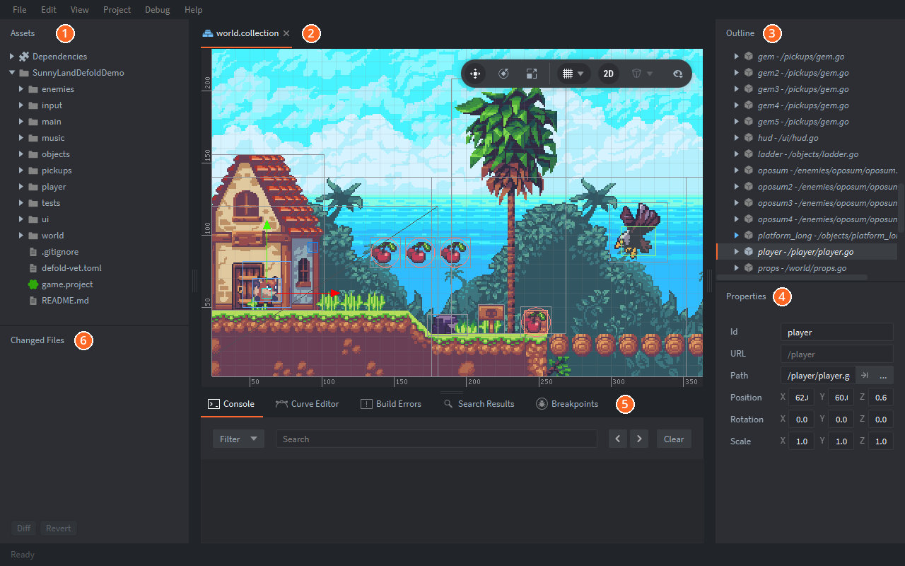
</p>

| | Pane | What it is for |
|---|---|---|
| **1** | **Assets** | Every file of the project. Double-click to open, right-click to create |
| **2** | **Editor** | The file that is open. A level or an object is drawn. A script or a settings file is a text or a form |
| **3** | **Outline** | What the open file contains, as a tree. Here, every game object in the level |
| **4** | **Properties** | The fields of whatever is selected. Here the fox: its id, its address, its file and where it stands |
| **5** | **Tools** | The **Console** with what the game prints, build errors, search results and the debugger |
| **6** | **Changed Files** | What git thinks you changed |

The keys worth learning on the first day:

| Key | Does |
|---|---|
| `Ctrl+B` | Builds the game and runs it |
| `Ctrl+P` | Opens a file by name |
| `Ctrl+R` | Hot reload: sends the file you are editing to the game that is running |
| `Ctrl+Shift+F` | Searches every file of the project |
| `F` | Frames the selection in the view |
| `W`, `E`, `R` | Move, rotate and scale tools |
| Mouse wheel, `Alt` + drag | Zoom and pan the view |
| `F6`, `F7`, `F8` | Hide and show the Assets, the Tools and the right-hand panes |

A script opens in the built-in code editor, with completion and a debugger. You may
also write code in an editor of your own and keep Defold for everything else: the path
to it goes in **File ▸ Preferences ▸ Code**. The file below is
`objects/moving_platform.script`, the whole behaviour of a moving platform. Lesson 5
reads it line by line.

<p align="center">
  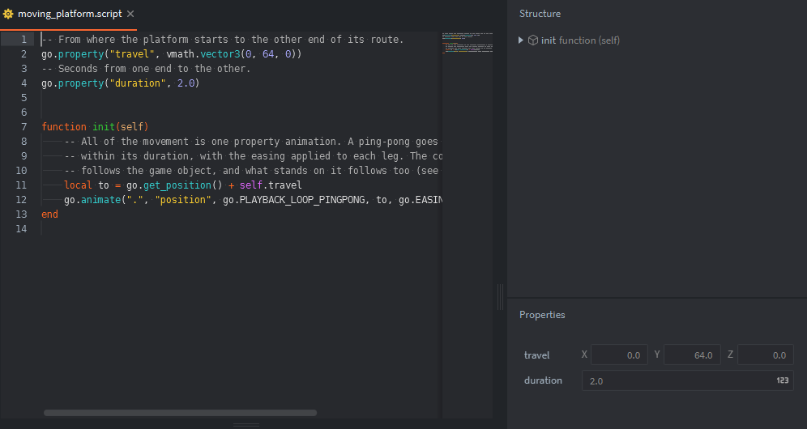
</p>

> **Try it.** Select `player` in the Outline and drag the red arrow that appears on the
> fox. Press `Ctrl+B`. The fox starts where you left it. `Ctrl+Z` puts it back.

More: [The editor](https://defold.com/manuals/editor/),
[Scene editing](https://defold.com/manuals/scene-editing/).

### 3. A project is a folder of text

A Defold project is a folder with a file called `game.project` in it. That file is the
settings of the game, in INI format, and it is the first thing the engine reads. This
is most of the one in this project:

<table>
<tr>
<td width="45%" valign="top">

```ini
[project]
title = SunnyLand

[bootstrap]
main_collection = /main/main.collectionc

[display]
width = 1080
height = 720

[engine]
fixed_update_frequency = 60

[physics]
use_fixed_timestep = 1

[graphics]
default_texture_min_filter = nearest
default_texture_mag_filter = nearest

[input]
game_binding = /input/game.input_bindingc
```

</td>
<td valign="top">
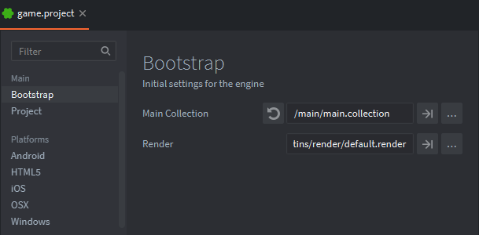

The editor shows the same file as a form. Both are the same thing, and you may edit
either.

</td>
</tr>
</table>

| Setting | What it decides |
|---|---|
| `[bootstrap] main_collection` | The collection the engine loads when the game starts. The trailing `c` means "compiled": the build turns `main.collection` into `main.collectionc` |
| `[display] width`, `height` | The size of the window, and the size the GUI is laid out for |
| `[engine] fixed_update_frequency` | How many times a second `fixed_update` runs (lesson 16) |
| `[physics] use_fixed_timestep` | Makes the physics step at that same rate |
| `[graphics] default_texture_*_filter` | `nearest` keeps pixel art sharp. The default, `linear`, blurs it |
| `[input] game_binding` | The file that names the keys (lesson 12) |

Every other file follows the same idea. Each kind of thing has its own extension, and
all of them are text:

| File | Is |
|---|---|
| `.collection` | A scene: a tree of game objects |
| `.go` | One game object, as a blueprint to place many times |
| `.script` | A Lua script for a game object |
| `.lua` | A Lua module, shared between scripts |
| `.atlas`, `.tilesource` | Images and the animations made of them |
| `.tilemap` | A level painted with tiles |
| `.gui`, `.gui_script` | A user interface and its script |
| `.font` | A font, built from a `.ttf` |
| `.input_binding` | Which key means which action |

One file points at another by its path from the root of the project, starting with a
slash: `/world/world.go`. Rename a file in the editor and every path to it is updated.

The folders `build/` and `.internal/` and the file `.editor_settings` belong to the
editor. They are in `.gitignore`, and you can delete them at any time.

More: [Project settings](https://defold.com/manuals/project-settings/).

### 4. Game objects, components and collections

These three words are most of Defold.

A **game object** is an id, a position, a rotation, a scale, and a list of
**components**. That is all it is. It draws nothing and does nothing. The components
do. Open `player/player.go`:

<p align="center">
  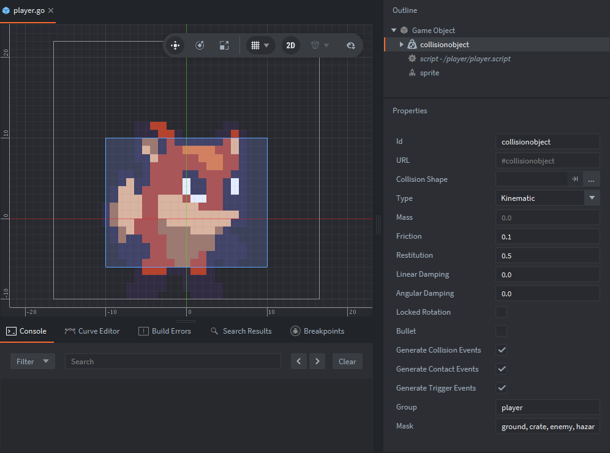
</p>

The fox is the three components listed in the Outline:

- `sprite` draws it
- `collisionobject` gives it a body in the physics world
- `script` is its behaviour, in `player.script`

Select one and its fields show up in the Properties. Here it is the collision object:
its type, the group it belongs to and the groups it touches. Lesson 13 explains all
three. The box drawn over the fox is its collision shape, smaller than the picture on
purpose.

The file says the same thing as the editor, with less ceremony:

```
components {
  id: "script"
  component: "/player/player.script"
}
embedded_components {
  id: "sprite"
  type: "sprite"
  data: "default_animation: \"idle\"\n"
  ...
}
embedded_components {
  id: "collisionobject"
  type: "collisionobject"
  data: "type: COLLISION_OBJECT_TYPE_KINEMATIC\n"
  ...
}
```

A component is either a file of its own (`components`, the script) or written inside
the game object (`embedded_components`, the sprite). Each has an id, and that id is how
a script will address it.

These are the components this game uses:

| Component | Does | Example here |
|---|---|---|
| Sprite | Draws an image or an animation | Almost everything |
| Tile map | Draws a level made of tiles | `world/tilemap.go` |
| Collision object | A shape in the physics world | Everything that can be touched |
| Script | Behaviour, in Lua | 15 of them |
| Sound | Plays a sound | The music, in `world/world.go` |
| Factory | Creates game objects at run time | The sparkle of a pickup |
| Camera | Decides what part of the world is on screen | `world/camera.go` |
| GUI | A user interface | The HUD, in `ui/hud.go` |
| Collection proxy | Loads another collection at run time | `main/loader.go` |

A `.go` file is a blueprint. The thing that exists in the game is an **instance** of
it, and instances live in a **collection**. This level has 66 of them, made from 28
blueprints. All twenty cherries are `pickups/cherry.go`:

```
instances {
  id: "cherry"
  prototype: "/pickups/cherry.go"
  position {
    x: 144.0
    y: 88.0
    z: 0.503
  }
}
```

The id is what makes one cherry different from the next. Inside its collection a game
object is known as `/` plus its id: `/cherry`, `/player`, `/crusher`.

A game object can be the **child** of another, and then it moves, turns and scales with
its parent. That is the whole meaning of a parent in Defold. A child inherits the
transform and nothing else. This game uses it twice: the two background layers are
children of the camera so that they stay in view, and a pickup placed as a child of a
crate is how the level says "this cherry is inside that crate".

```
instances {
  id: "crate"
  prototype: "/objects/crate.go"
  children: "cherry19"
  ...
}
```

Several things in this level are game objects with no script at all. The spikes are a
sprite and a collision object. The ladder is a collision object and nothing else, not
even a picture, because the picture is in the tile map. Whoever touches them does the
reacting.

> **Try it.** In `world.collection`, right-click `Collection` at the top of the
> Outline, choose **Add Game Object File** and pick `pickups/cherry.go`. Move the new
> cherry somewhere the fox can reach and build. The final screen now counts 21
> cherries. Nobody told it to: lesson 8 shows why.

More: [Building blocks](https://defold.com/manuals/building-blocks/),
[Components](https://defold.com/manuals/components/).

### 5. Scripts

A script is a Lua file with functions the engine knows by name. You do not call them.
The engine does:

| Function | The engine calls it |
|---|---|
| `init(self)` | Once, when the game object is created |
| `final(self)` | Once, when it is deleted |
| `fixed_update(self, dt)` | At a fixed rate, 60 times a second in this project |
| `update(self, dt)` | Once per frame |
| `late_update(self, dt)` | Once per frame, after every `update` |
| `on_message(self, message_id, message, sender)` | When a message arrives |
| `on_input(self, action_id, action)` | When a key is pressed, if the script asked for input |
| `on_reload(self)` | After a hot reload |

Define only the ones you need. A script that leaves one out costs nothing for it.

`self` is the memory of one instance. Two cherries run the same `pickup.script`, and
each gets a `self` of its own. `dt` is the time since the last call, in seconds.

<table>
<tr>
<td width="55%" valign="top">

`objects/moving_platform.script`, all of it but one comment:

```lua
-- From where the platform starts to the other
-- end of its route.
go.property("travel", vmath.vector3(0, 64, 0))
-- Seconds from one end to the other.
go.property("duration", 2.0)

function init(self)
	local to = go.get_position() + self.travel
	go.animate(".", "position",
		go.PLAYBACK_LOOP_PINGPONG, to,
		go.EASING_INOUTSINE, self.duration * 2)
end
```

</td>
<td valign="top">
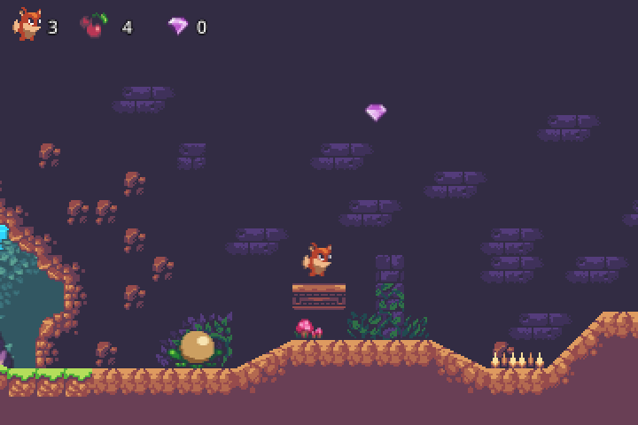

There is no `update` here. The platform asks the engine once to move it forever, and
the engine does.

</td>
</tr>
</table>

That is the usual shape of a Defold script: it sets things in motion and then waits to
be told that something happened. Nothing in this whole project defines `update`. What
moves the fox is in `fixed_update`, because movement has to give the same result at any
frame rate, and the rest is messages, timers and animations.

`go` is the module that deals with game objects: `go.get_position`, `go.set_position`,
`go.animate`, `go.delete`. With no address, a function acts on the game object the
script belongs to.

More: [Scripts](https://defold.com/manuals/script/),
[the `go` API](https://defold.com/ref/stable/go-lua/).

### 6. Script properties

The two `go.property` lines of the platform declare fields that can be set from
outside the code. They show up in the editor, and each instance may have its own
value.

<table>
<tr>
<td width="55%" valign="top">

`objects/crank.script` does not know which door it opens:

```lua
go.property("target", hash(""))
```

The level tells it. Select the crank in `world.collection`, open it in the Outline,
select its script, and there is the field, with `/door` in it. A value written in blue
is one that this instance changed.

In the file of the collection it looks like this:

```
instances {
  id: "crank"
  prototype: "/objects/crank.go"
  component_properties {
    id: "script"
    properties {
      id: "target"
      value: "/door"
      type: PROPERTY_TYPE_HASH
    }
  }
}
```

</td>
<td valign="top" align="center">
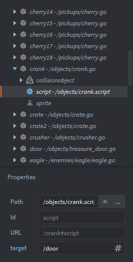
</td>
</tr>
</table>

A property has three places to get its value from, and the nearest one wins: the
default in the script, the game object file, the instance in the collection.
`pickup.script` uses the middle one. It is one script for cherries and gems, and
`cherry.go` and `gem.go` each set its `kind`.

Inside the script a property is a field of `self`: `self.target`, `self.travel`. From
another script it is read and written by address:

```lua
go.get("/player#script", "health")
go.set("/player#script", "health", 3)
```

A property is a number, a boolean, a hash, a URL, a `vector3`, a `vector4`, a
quaternion or a resource. There are no string properties, which is why `kind` is
`hash("cherry")` and not `"cherry"`.

> **Try it.** Select `platform_long` in the level, then its script, and change `travel`
> to `120, 0, 0`. The platform now goes sideways, and the fox still rides it.

More: [Script properties](https://defold.com/manuals/script-properties/).

### 7. Addresses

Everything that exists in a running game has an address, called a URL, in three parts:

```
world:/player#sprite
  |      |       |
  |      |       the component
  |      the game object
  the collection that was loaded
```

Most of the time you write only the part that changes:

| You write | It means | As in |
|---|---|---|
| `"."` | This game object | `msg.post(".", "acquire_input_focus")` |
| `"#sprite"` | The component `sprite` of this game object | `sprite.play_flipbook("#sprite", "crank-down")` |
| `"/hud#hud"` | The component `hud` of the game object `/hud`, in this collection | `msg.post("/hud#hud", "set_health", ...)` |
| `"/crusher"` | The game object `/crusher`, in this collection | `go.get_position("/crusher")` |
| `"main:/loader#loader"` | A component in another loaded collection | `msg.post("main:/loader#loader", "restart")` |
| `"@system:"` | The engine itself | `msg.post("@system:", "toggle_physics_debug")` |

`print(msg.url())` shows where a script is. In `world.script` it prints
`url: [world:/world#script]`.

Ids, message names and animation names are not kept as strings. The engine turns each
one into a number, a **hash**, and compares numbers. So a script compares against
`hash("name")`, and the habit in this project is to do the hashing once, at the top of
the file:

```lua
local JUMP = hash("jump")
local TRIGGER_RESPONSE = hash("trigger_response")
```

Where an API takes an address or a name, a plain string works too, and the engine
hashes it for you.

An address is a string, and nothing checks a string. `"#spirte"` is valid Lua and
reaches nobody. That is the most common Defold mistake, and
[Defold Tools](https://github.com/Lanterna-Games/defold-tools) exists to catch it.

More: [Addressing](https://defold.com/manuals/addressing/).

### 8. Messages

A script cannot call a function of another script. It posts a message to an address:

```lua
msg.post(receiver, message_id, { some = "data" })
```

and the script at that address gets it in `on_message`:

```lua
function on_message(self, message_id, message, sender)
```

<table>
<tr>
<td width="50%" valign="top">

Pulling the crank is three scripts and two messages.

`player.script` posts to whatever it is standing next to:

```lua
msg.post(self.interactable, "interact")
```

`crank.script` flips its sprite and passes it on to its target:

```lua
if message_id == INTERACT and not self.pulled then
	self.pulled = true
	sprite.play_flipbook("#sprite", "crank-down")
	msg.post(self.target, "open")
end
```

`treasure_door.script` opens and lets the gem out:

```lua
elseif message_id == OPEN then
	sprite.play_flipbook("#sprite", "door-opened")
	if self.gem then
		msg.post(self.gem, "enable")
	end
end
```

</td>
<td valign="top">
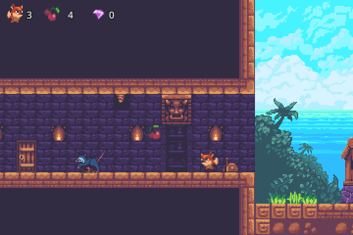

None of the three knows the other two. The fox does not know it is a crank. The crank
does not know it is a door.

</td>
</tr>
</table>

Four things to know about messages, all of them in that example:

- **A message is not a call.** `msg.post` puts it in a queue and returns at once. The
  receiver gets it a moment later, normally within the same frame. Do not count on its
  effect on the next line, and do not expect a return value.
- **An answer is another message.** `sender` is the address the message came from. The
  HUD is asked to `fade_out`, and when the screen is dark it posts `faded` back to
  `sender`.
- **The data is a table** of numbers, strings, booleans, hashes, URLs, vectors and
  other tables. No functions. It has to fit in 2 kilobytes.
- **Some messages belong to the engine.** `enable` in the last snippet is one: the
  script does not handle it, the engine does, and the gem's sprite and collision
  object are switched back on.

The engine messages this game uses:

| Message | Posted to | Does |
|---|---|---|
| `acquire_input_focus`, `release_input_focus` | A game object | Starts and stops its `on_input` |
| `enable`, `disable` | A game object or a component | Switches it on and off. A disabled sprite is not drawn, a disabled collision object touches nothing |
| `load`, `init`, `enable`, `unload` | A collection proxy | Lesson 20 |
| `contact_point_response`, `trigger_response` | By the physics, to your script | Lesson 14 |

A message posted to a game object reaches all of its components. A message posted from
`init` is delivered after every `init` has run. That is how each pickup can announce
itself to the level, which counts them, and why the cherry you added in lesson 4 was
counted with no extra work:

```lua
-- pickups/pickup.script
function init(self)
	msg.post(WORLD, "pickup_added", { kind = self.kind })
```

The complete list of who says what to whom is in the [reference](#reference).

> **Try it.** Add `print(message_id, sender)` as the first line of `on_message` in
> `world/world.script`, build, and watch the Console while you play.

More: [Message passing](https://defold.com/manuals/message-passing/).

### 9. Lua modules

Messages are for telling another object that something happened. For sharing code,
there are Lua modules. A module is a `.lua` file that returns a table of functions:

```lua
-- world/kinematic.lua
local M = {}

function M.new(half_width, feet)
	return { velocity = vmath.vector3(), ... }
end

function M.move(body, dt)
	...
end

return M
```

```lua
-- player/player.script
local kinematic = require("world.kinematic")

function init(self)
	self.body = kinematic.new(HALF_WIDTH, HALF_HEIGHT)
end

function fixed_update(self, dt)
	local floor = kinematic.move(self.body, dt)
end
```

The name given to `require` is the path of the file with dots for slashes and no
extension. It has to be written out as a string, because the build reads it to know
which files go into the game.

There is no inheritance between scripts, so this is also how three enemies share what
they have in common. `enemies/enemy.lua` has the death of an enemy, and the eagle, the
frog and the opossum call it from their own `on_message`.

**All scripts share one Lua.** The engine loads a module once and hands the same table
to everyone who requires it. A `local` at the top of a module is therefore one variable
for the whole game, and so is a `local` at the top of a script file: it is shared by
every instance of that script. Two rules follow, and this project keeps both:

- State belongs in `self`. `kinematic.new` returns a table, and each script keeps its
  own in `self.body`.
- Always write `local`. A variable without it is a global, visible from every script
  in the game, GUI scripts included.

The tables `go`, `gui` and `render` are visible from every script too, but each one
only works in its own kind of script. Call `go.get_position` from a GUI script and the
engine answers:

```
You can only access go.* functions and values from a script instance (.script file)
```

So the HUD cannot ask the fox for its health. It has to be told, by message.

More: [Modules](https://defold.com/manuals/modules/),
[Lua in Defold](https://defold.com/manuals/lua/).

### 10. Sprites, atlases and tile sources

A sprite component does not point at an image. It points at an **atlas** or a **tile
source**, which is a set of images packed into one texture, with animations defined on
top.

**An atlas** is a list of separate image files. An animation is any list of them, in
any order, and may use the same image twice. The build packs all of them into one
texture, as tightly as it can. This is `pickups/pickups.atlas`, with its three
animations in the Outline:

<p align="center">
  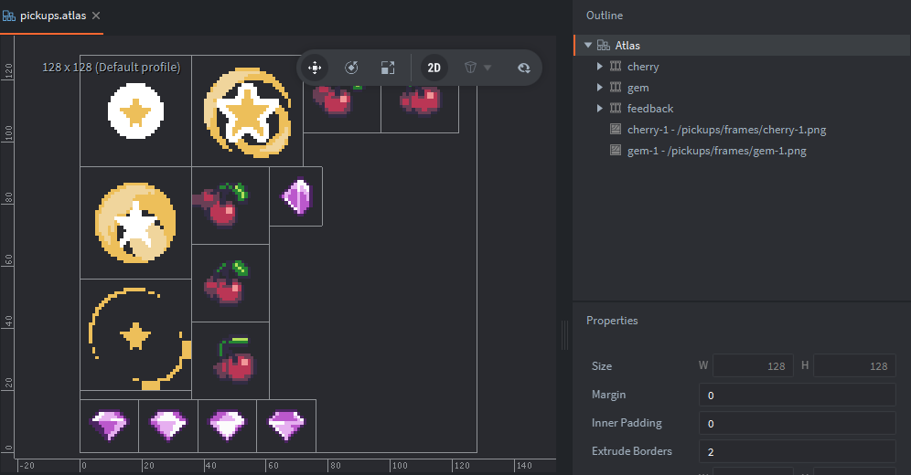
</p>

```
animations {
  id: "cherry"
  images { image: "/pickups/frames/cherry-2.png" }
  images { image: "/pickups/frames/cherry-3.png" }
  images { image: "/pickups/frames/cherry-4.png" }
  images { image: "/pickups/frames/cherry-5.png" }
  images { image: "/pickups/frames/cherry-4.png" }
  ...
  playback: PLAYBACK_LOOP_FORWARD
  fps: 12
}
```

**A tile source** is one image cut into a grid of equal tiles. An animation is a range
of tiles, counted from 1 at the top left. It is the natural fit for a sprite sheet,
which is how this art pack comes. This is `player/player.tilesource`, with the
animation `run` selected: tiles 7 to 12, the second row.

<p align="center">
  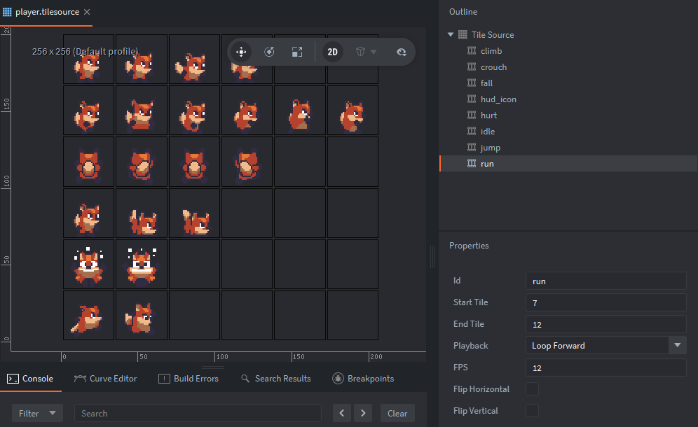
</p>

```
animations {
  id: "run"
  start_tile: 7
  end_tile: 12
  playback: PLAYBACK_LOOP_FORWARD
  fps: 12
}
```

| | Atlas | Tile source |
|---|---|---|
| Made of | Separate image files of any size | One image, cut into a grid |
| An animation is | Any list of images | A range of tiles |
| Can feed | Sprites, GUI, particles | Sprites, GUI, particles, **tile maps** |
| Can carry collision shapes | No | Yes, one per tile |

The fox, the eagle and the opossum use tile sources, straight from their sheets. The
frog and the pickups use atlases: the frog's frames came in two sheets, and the
pickups' animations repeat frames and go back, which a range of tiles cannot say.

Playing an animation is one call. The second form runs a function when it ends, which
is the whole of `pickups/feedback.script`:

```lua
sprite.play_flipbook("#sprite", "run")

sprite.play_flipbook("#sprite", "feedback", function()
	go.delete()
end)
```

A sprite also has properties that `go.get`, `go.set` and `go.animate` reach. The blink
of a hurt fox is the alpha of its tint, `tint.w`, going up and down.

Three facts about drawing that are easy to miss:

- **y points up**, and the origin is at the bottom left.
- **z is the drawing order.** Higher is in front. It has to fit between the near and far
  planes of the camera, here -1 and 1. The sky is at -0.9, the tiles at 0, the fox at
  0.6.
- **Pixel art needs two settings**: the `nearest` filter in `game.project`, and
  **Extrude Borders** set to 2 in each atlas and tile source, which stops neighbouring
  images from bleeding into each other.

More: [Atlas](https://defold.com/manuals/atlas/),
[Tile source](https://defold.com/manuals/tilesource/),
[Sprite](https://defold.com/manuals/sprite/),
[Flipbook animation](https://defold.com/manuals/flipbook-animation/).

### 11. The tile map

<table>
<tr>
<td width="40%" valign="top">

The ground of the level is one component: a **tile map**, painted with the tiles of
`world/tileset.tilesource`. The file is a list of cells:

```
tile_set: "/world/tileset.tilesource"
layers {
  id: "layer"
  z: 0.0
  cell {
    x: 82
    y: 14
    tile: 402
  }
  ...
```

You do not write that by hand. Open `world/world.tilemap`, select the layer in the
Outline, press `Space` to pick a tile from the palette, and paint. `Shift` + click
picks up a tile that is already on the map.

</td>
<td>
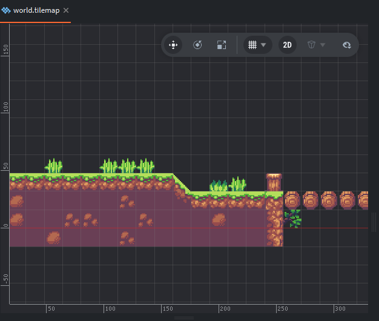
</td>
</tr>
</table>

A tile map is a component like any other, so it lives in a game object,
`world/tilemap.go`, which is placed in the level. Trees, houses and bushes are not
tiles. They are sprites in `world/props.go`, behind the tiles, and
`world/props_front.go`, in front.

The map only draws. What makes the ground solid is in lesson 13.

More: [Tile map](https://defold.com/manuals/tilemap/).

### 12. Input

<table>
<tr>
<td width="40%" valign="top">

A script never asks "is the left arrow down?". Keys are given names in a file,
`input/game.input_binding`, and a script hears about the names. Those names are called
**actions**:

```
key_trigger {
  input: KEY_SPACE
  action: "jump"
}
gamepad_trigger {
  input: GAMEPAD_RPAD_DOWN
  action: "jump"
}
```

Space, Enter and the A button all mean `jump`, and the script that jumps does not know
there are three of them.

</td>
<td>
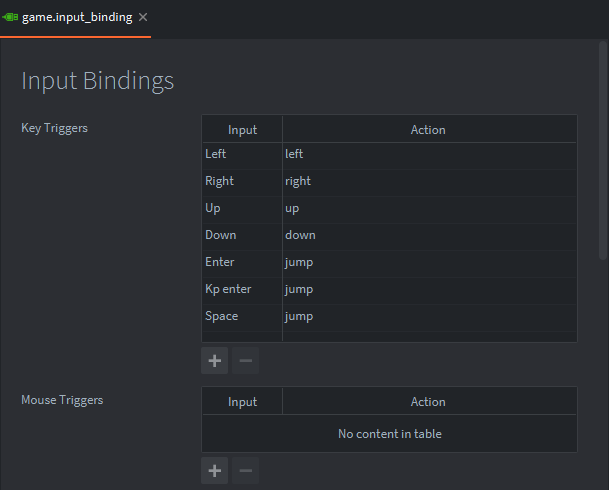
</td>
</tr>
</table>

A script gets no input until it asks for it. `player.script` asks in its `init`:

```lua
msg.post(".", "acquire_input_focus")
```

From then on the engine calls `on_input` with the action and a table about it. In
this script `on_input` passes both straight to this function:

```lua
local function handle_input(self, action_id, action)
	if action_id == JUMP then
		if action.pressed then
			self.jump = true
		end
	elseif action_id == LEFT or action_id == RIGHT or action_id == UP or action_id == DOWN then
		self.held[action_id] = not action.released and action.value > DEADZONE
	end
end
```

| Field | Is |
|---|---|
| `action.pressed` | True on the frame the key went down |
| `action.released` | True on the frame it came up |
| `action.value` | 1 while a key is held. For a stick, how far it is pushed, from 0 to 1 |

The fox does not move in `on_input`. It writes down what is held and whether jump was
pressed, and `fixed_update` reads that. The reason is that the two run at different
rates: input arrives once per frame, the movement runs at its own fixed rate, and a
press must not be lost between them.

The scripts that asked for input form a stack. The last one to ask hears first, and a
script that returns `true` from `on_input` keeps the action for itself.

Asking for input can wait until it is wanted. `world.script` asks only when the level
is complete, and from then on jump starts the level again.

More: [Input](https://defold.com/manuals/input/).

### 13. Collision objects

Nothing in this project tests one shape against another. Shapes are drawn in the
editor, the engine finds out who touches whom, and the code reacts.

A **collision object** is the component that gives a game object a shape in the physics
world. Its **type** decides who moves it:

| Type | Who moves it | What the engine does | Here |
|---|---|---|---|
| **Static** | Nobody. It never moves | Lets others collide with it | The ground, crates, blocks, spikes |
| **Dynamic** | The physics simulation | Everything: gravity, bounces, pushes | Nothing. See below |
| **Kinematic** | Your script | Only reports what it touches | The fox, the enemies, the platforms, the crusher |
| **Trigger** | Your script, if anyone | Reports what enters and what leaves. Blocks nothing | Pickups, the ladder, the crank, the exit door |

A platformer hero made of a dynamic object feels like a crate on ice, because that is
what it is to the simulation. Like most platformers, this one uses kinematic objects
and decides for itself what a collision means.

Every collision object is in one **group** and has a **mask**, the list of groups it
wants to touch. Two objects collide only if each has the other's group in its mask.
Both sides have to agree. The fox, as lesson 4 showed, is in `player` and its mask
lists the eight groups it cares about. An eagle is in `enemy` and its mask is `player`
alone, so eagles fly through walls and through each other.

<table>
<tr>
<td width="40%" valign="top">

This is the start of the level with the physics world drawn on top:

- the ground, with its slope, and the bridge of logs, which is a thinner strip
- a circle around each cherry
- a box for the crate, with the circle of the cherry hidden in it
- a box for the fox, smaller than the fox
- a box for the eagle

To see it yourself, set `debug = 1` under `[physics]` in `game.project`. A script can
also switch it on and off while the game runs:

```lua
msg.post("@system:", "toggle_physics_debug")
```

</td>
<td>
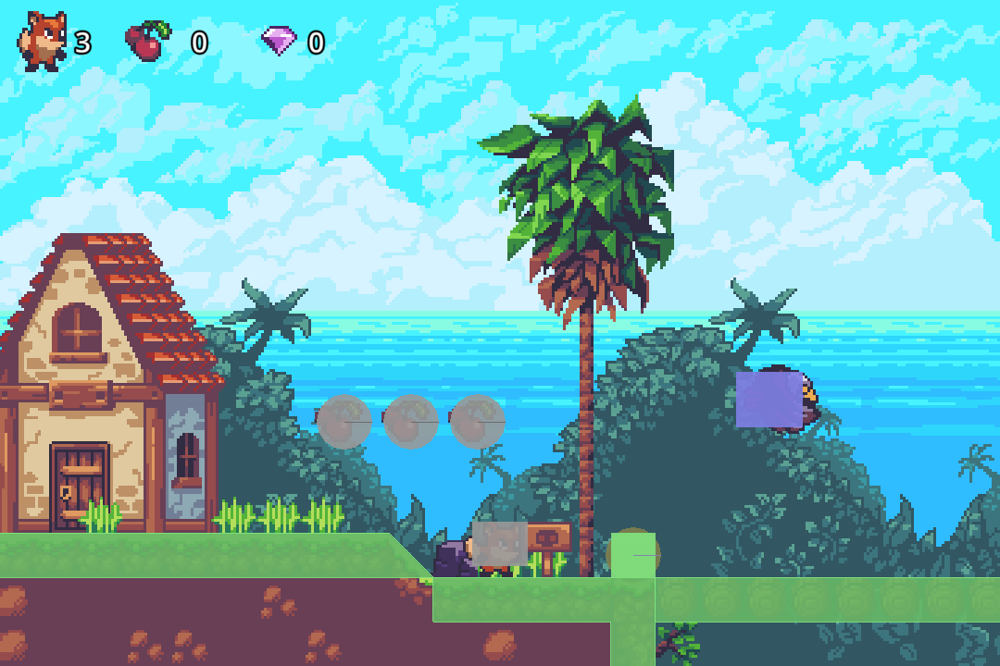
</td>
</tr>
</table>

**The ground gets its shape from the tiles.** `world/tileset.tilesource` has a second
image, `tileset_collision.png`, where each tile that collides is painted in the shape
it should have. The engine wraps the painted pixels of each tile in a convex outline,
drawn below in pink. A full tile becomes a square and a slope becomes a triangle.

<p align="center">
  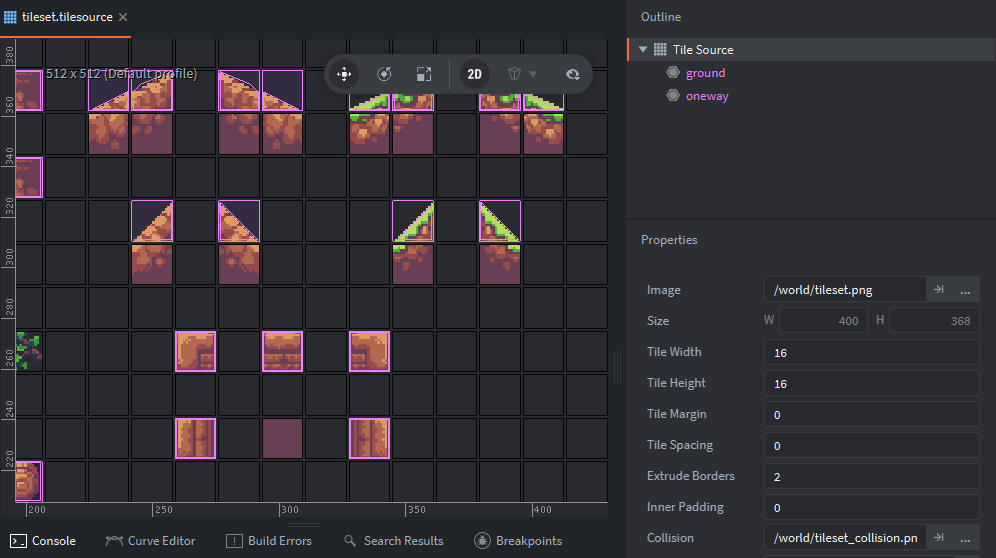
</p>

Each of those tiles is then put in a group. The tile source has two, `ground` and
`oneway`, listed in the Outline. To assign one, select it there and click the tiles.

`world/tilemap.go` has a collision object whose shape is the tile map itself. That is
one component, and the whole level is solid.

The groups of this game are in the [reference](#reference).

More: [Collision objects](https://defold.com/manuals/physics-objects/),
[Collision shapes](https://defold.com/manuals/physics-shapes/),
[Groups and masks](https://defold.com/manuals/physics-groups/).

### 14. Reacting to a collision

When two shapes meet, the engine posts a message to the scripts of both game objects.
Which message depends on the types:

| Message | Sent | Tells you |
|---|---|---|
| `trigger_response` | Once when something enters a trigger, once when it leaves | `other_id`, `other_group`, and `enter`, true or false |
| `contact_point_response` | On every step two solid shapes overlap | The same, plus the `normal` of the contact and the `distance` of the overlap |
| `collision_response` | Once per frame for each pair that overlaps | Only who it was. Enough for a bullet |

<table>
<tr>
<td width="50%" valign="top">

**A trigger is an area that notices.** A pickup is a sprite, a round trigger whose mask
is `player`, and this:

```lua
-- pickups/pickup.script
if message_id == TRIGGER_RESPONSE and message.enter then
	msg.post(WORLD, "pickup_collected", { kind = self.kind })
	factory.create(FEEDBACK, position)
	go.delete()
end
```

The only thing its mask lets in is the fox, so it does not have to ask who came.

The ladder is the same idea turned around. It is a trigger with no script. The fox
gets the message and remembers that a ladder is in reach:

```lua
-- player/player.script
if message.other_group == LADDER then
	self.ladder = message.enter and message.other_id or nil
```

</td>
<td valign="top">
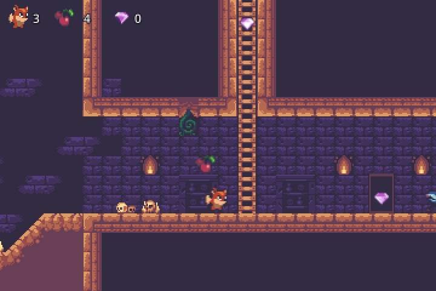
</td>
</tr>
<tr>
<td valign="top">

**Both sides are told, and one of them decides.** When the fox and an opossum touch,
both scripts get a `contact_point_response`. The fox is the one who knows how fast it
was falling, so the fox decides what the touch means, and tells the enemy:

```lua
-- player/player.script
local falling = not body.grounded and body.velocity.y < 0
if falling and go.get_position().y > message.other_position.y then
	body.velocity.y = BOUNCE_SPEED
	msg.post(message.other_id, "stomped")
else
	take_damage(self, message.other_position.x)
end
```

The opossum's side of it is two lines: on `stomped`, die.

</td>
<td valign="top">
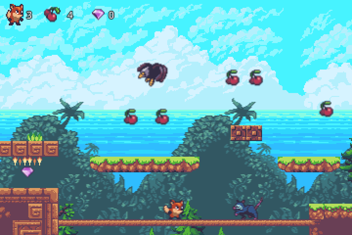
</td>
</tr>
<tr>
<td valign="top">

**One game object may have several collision objects.** The crusher has three, and
their messages all arrive in the same script:

- `body`, the block itself, solid, in the group `ground`
- `trigger`, the tall box under it, which sets it off
- `hurtbox`, a thin strip under its face, in the group `hazard`, switched on only while
  it falls

`message.own_group` tells them apart:

```lua
elseif message_id == CONTACT_POINT_RESPONSE
		and message.own_group == HAZARD and self.falling then
```

and a collision object is switched on and off like anything else:

```lua
msg.post("#hurtbox", "disable")
```

</td>
<td valign="top">
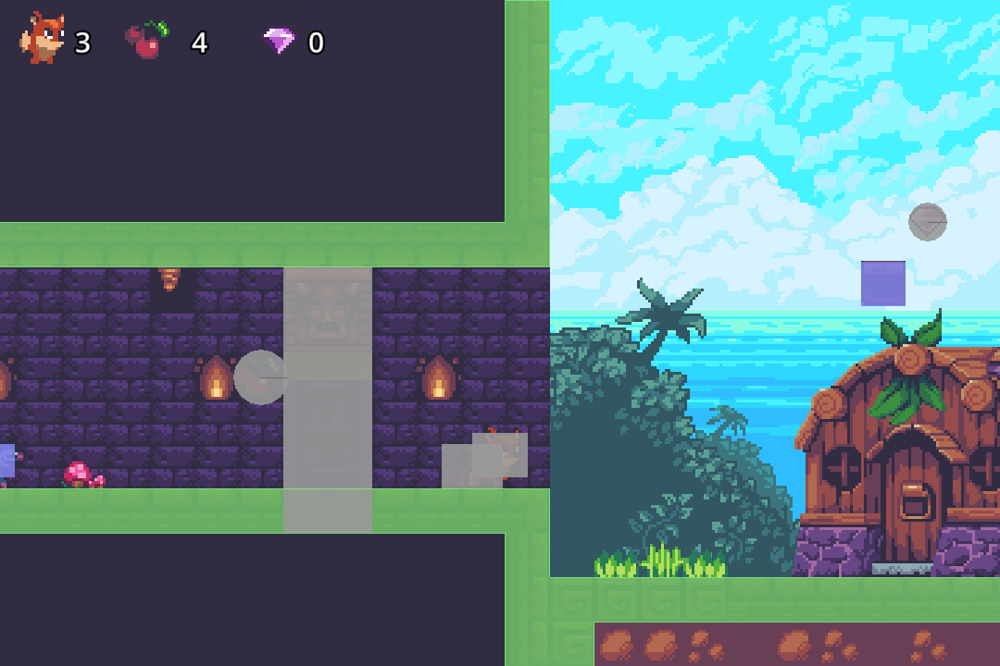
</td>
</tr>
</table>

Messages are the engine telling you. To ask instead, there is the ray cast, which
answers at once:

```lua
local hit = physics.raycast(from, to, { hash("ground"), hash("oneway") })
if hit then
	print(hit.id, hit.group, hit.position, hit.normal)
end
```

More: [Collision messages](https://defold.com/manuals/physics-messages/),
[Ray casts](https://defold.com/manuals/physics-ray-casts/).

### 15. Moving a kinematic body

This is the one hard lesson, and it is hard in every engine.

Defold never moves a kinematic object and never stops one. The script sets its
position, and if that position is inside a wall, the engine reports the overlap and
leaves it there. Getting out is your job. This project does it in one small module,
`world/kinematic.lua`, used by the fox, the frog and the opossum. It splits the work
in two.

**Floors are found before moving, with ray casts.** Three rays go down from the body,
one at each edge and one in the middle, over the distance it is about to fall. A hit
means the body is put exactly on the floor instead of sinking into it and being pushed
back out:

```lua
local hit = physics.raycast(from, to, FLOORS)
```

The same rays make two other things cheap. A body on the ground looks a few pixels
further down than it needs to, so it follows a slope on the way down instead of hopping
off it. And a ray that starts inside a shape does not hit that shape, so a fox jumping
up through a one-way platform does not see it, and lands on it on the way down. The
bridge of logs in the first picture works like that, and so does every moving
platform.

**Walls and ceilings are left to contact points, after moving.** The body moves into
the wall, the physics reports the overlap, and the module pushes the body back out
along the normal. This is the method from the Defold manual. Several contact points
may report the same overlap, so each one only adds what the earlier ones left
uncorrected:

```lua
local projection = vmath.project(body.correction, normal * distance)
if projection < 1 then
	local compensation = (distance - distance * projection) * normal
	go.set_position(go.get_position() + compensation)
	body.correction = body.correction + compensation
end
```

Two details hold it together:

- The collision shape of a body ends a few pixels above its feet, and the rays start
  at that height. Whatever is lower than that is stepped onto and never bumped into.
  Without the gap, a body walking over the seam between two floor tiles gets an
  occasional sideways contact from the corner of the next tile, and stops dead.
- Kinematic objects do not push each other. A fox standing on a moving platform has to
  follow it, and does, in `late_update`: by the distance the platform moved since last
  time.

A script that uses the module is three calls:

```lua
function fixed_update(self, dt)
	kinematic.move(self.body, dt)
end

function late_update(self, dt)
	kinematic.ride(self.body)
end

function on_message(self, message_id, message, sender)
	if message_id == CONTACT_POINT_RESPONSE then
		kinematic.contact(self.body, message)
	end
end
```

More: [Resolving kinematic collisions](https://defold.com/manuals/physics-resolving-collisions/).

### 16. Time

A frame in Defold goes through the scripts in a fixed order:

1. **Input** is delivered.
2. **`fixed_update`** runs, as many times as it takes to keep its rate. After each one
   the physics takes a step and the collision messages are delivered.
3. **`update`** runs, and the property animations move what they move.
4. **`late_update`** runs.
5. Game objects that were deleted go away, and the frame is drawn.

Messages are delivered between each of those steps.

`fixed_update` runs at `fixed_update_frequency`, 60 times a second, whatever the frame
rate. With `use_fixed_timestep` on, the physics steps with it. That is where the fox
moves, and it is why a jump is the same height on a slow laptop and on a 240 Hz
monitor.

The order does a job here without any script knowing about another. Bodies move in
step 2. Platforms move in step 3. In step 4 the riders catch up with their platform
and the camera goes to where the fox ended up.

Everything else that happens over time is one of two calls.

**`go.animate` changes a property over time.** Any property: a position, a tint, a
script property of your own.

```lua
go.animate(url, property, playback, to, easing, duration, delay, when_done)
```

**`timer.delay` calls a function later**, once or repeatedly:

```lua
timer.delay(seconds, repeating, callback)
```

<table>
<tr>
<td width="55%" valign="top">

`objects/crusher.script` is both of them, one after the other. It waits a moment as a
warning, drops, holds, and goes back up slowly:

```lua
function slam(self)
	timer.delay(WARN_TIME, false, function()
		msg.post("#hurtbox", "enable")
		local bottom = self.top - self.drop_distance
		go.animate(".", "position.y",
			go.PLAYBACK_ONCE_FORWARD, bottom,
			go.EASING_LINEAR, FALL_TIME, 0,
			function()
				rise(self)
			end)
	end)
end
```

`rise` is one more `go.animate`, with `HOLD_TIME` as its delay. The hold needs no
timer.

</td>
<td valign="top">
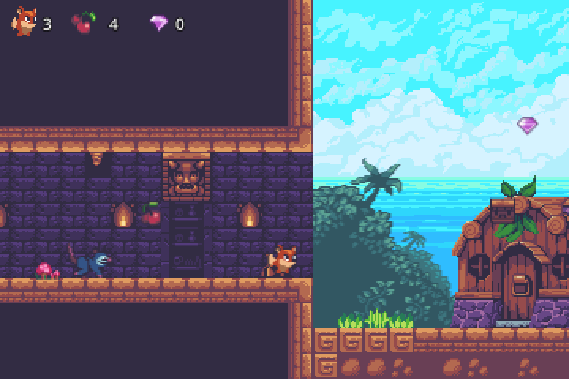
</td>
</tr>
</table>

| What happens | How |
|---|---|
| A platform goes back and forth | One `go.animate`, ping-pong, for ever |
| An eagle patrols | A `go.animate` to one end. When it completes, another to the other end |
| A frog jumps every two seconds | A repeating `timer.delay` |
| A hurt fox blinks | A ping-pong `go.animate` on `tint.w`, and a timer that ends it |
| A stomped enemy hops and drops off the screen | Two `go.animate` in a row. The last one deletes the game object |

None of them has a line in an update function, and none of them needs a variable that
counts seconds.

More: [Application lifecycle](https://defold.com/manuals/application-lifecycle/),
[Property animation](https://defold.com/manuals/property-animation/),
[the `timer` API](https://defold.com/ref/stable/timer-lua/).

### 17. Factories

Everything so far was placed in the level by hand. A **factory** is the component that
creates a game object while the game runs. It holds a blueprint, and any script can ask
it for a copy.

`world/world.go` has one, called `feedback`, whose blueprint is `pickups/feedback.go`:
the sparkle left by something collected or broken. A pickup that was just taken asks
for one where it stands:

```lua
local position = go.get_position()
position.z = FEEDBACK_Z
factory.create("/world#feedback", position)
go.delete()
```

The sparkle is a sprite and a script of four lines. It plays its animation once and
deletes itself when the animation ends, which was the second snippet of lesson 10.

`go.delete()` marks the game object and returns. It is gone at the end of the frame.
Until then it still exists and may still get a message.

A cherry inside a crate must not vanish with the crate. So in its `init`, a pickup
that has a parent leaves it at once, keeping its place in the world, switches itself
off and tells the parent it is in there:

```lua
local parent = go.get_parent()
if parent then
	go.set_parent(".", nil, true)
	msg.post(".", "disable")
	msg.post(parent, "stashed")
end
```

When the crate breaks, it posts `enable` to what it was holding and deletes itself.

More: [Factory](https://defold.com/manuals/factory/).

### 18. The camera

The level is 3600 pixels wide and the window shows 360 of them at a time. The
**camera** component decides which.

`world/camera.go` has a camera and a script. The component is set up once, in the
editor: an orthographic projection, a zoom of 3 so that one pixel of art is three on
the screen, and the mode **Auto Fit**, which keeps the display size of `game.project`
inside the window whatever shape the window is. A wider window shows more level. The
engine draws the world through it without being asked.

The script only says where the camera is. It runs in `late_update`, after everything
has moved, so that it goes to where the fox will be drawn and not to where it was:

```lua
-- width is how much of the level fits in the window
local position = go.get_position()
local target = go.get_position(self.target)
position.x = math.max(target.x, self.limit_left + width / 2)
position.x = math.min(position.x, self.limit_right - width / 2)
go.set_position(position)
```

The target and the four limits are script properties, so a different level sets them
in the editor.

The two background layers, the sky and the hills, are children of the camera. They
follow it by themselves and never leave the view. The script moves them a little
against the camera's direction, each at its own rate, and that is the parallax of the
first picture on this page.

More: [Camera](https://defold.com/manuals/camera/).

### 19. The GUI

The HUD is not in the world. A **GUI** component is drawn on top of everything, in the
coordinates of the screen, and the camera does not move it.

A GUI is a scene of its own, `ui/hud.gui`, made of **nodes**: boxes, which show a
colour or a picture, and texts. Nodes can be children of nodes.

<p align="center">
  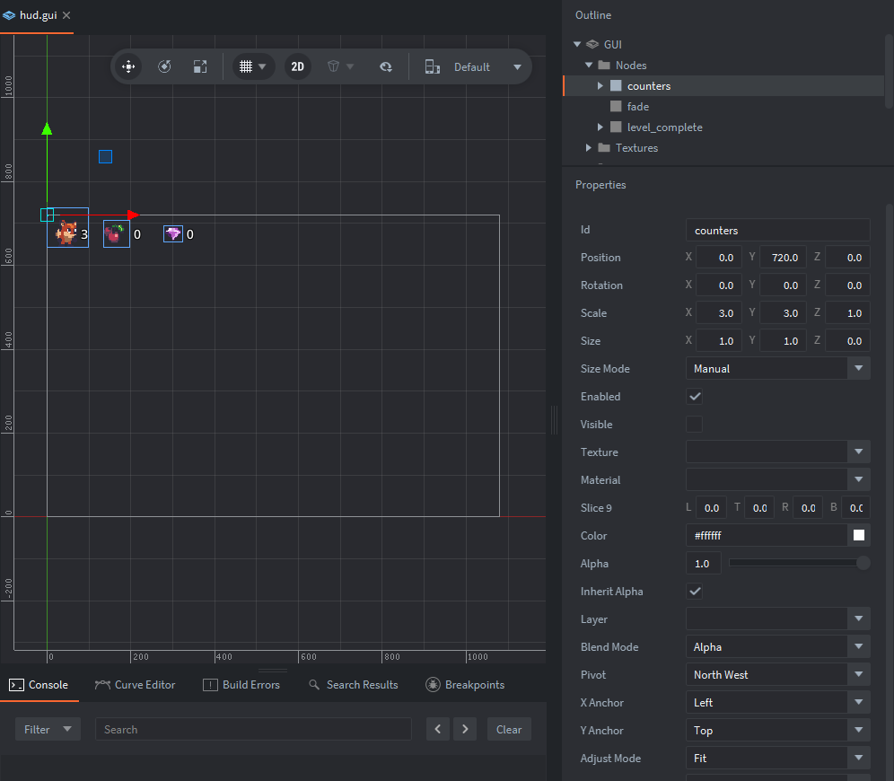
</p>

It is laid out for the display size of `game.project`, the white frame in the picture.
What keeps it in place when the window is another size is in the properties of each
node, near the bottom of the list:

- an **anchor** pins a node to an edge. The three counters are in the node selected
  above, `counters`, pinned to the left and to the top
- an **adjust mode** says how a node grows. `fade`, the black box that covers the
  screen, is set to stretch, so it always covers all of it

Nothing in the code deals with the size of the window.

<table>
<tr>
<td width="55%" valign="top">

A GUI has a script of its own kind, a `.gui_script`, and its own API, `gui.*`. It gets
nodes by id and changes them:

```lua
-- ui/hud.gui_script
if message_id == SET_HEALTH then
	gui.set_text(gui.get_node("health"),
		tostring(message.health))
elseif message_id == FADE_OUT then
	gui.animate(gui.get_node("fade"), "color.w",
		1.0, gui.EASING_LINEAR, FADE_TIME, 0,
		function()
			msg.post(sender, "faded")
		end)
```

As lesson 9 said, a GUI script cannot use `go.*`. Everything the HUD shows arrives as
a message, and the one thing it has to say, it says with a message.

The panel of the final screen was there all along, as a node that starts disabled.

</td>
<td valign="top">
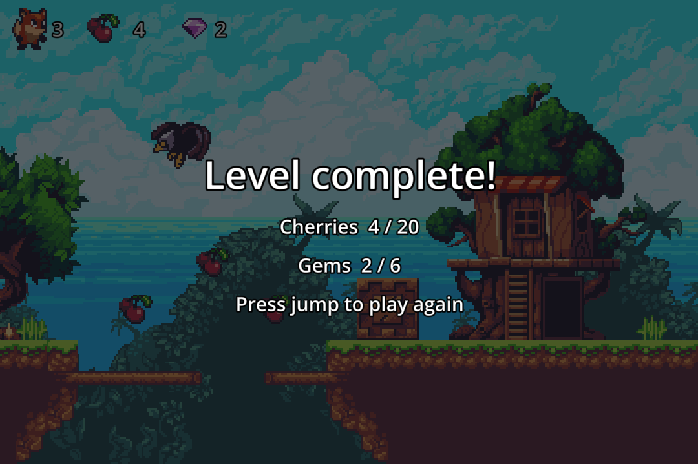
</td>
</tr>
</table>

More: [GUI](https://defold.com/manuals/gui/),
[GUI scripts](https://defold.com/manuals/gui-script/),
[GUI layouts](https://defold.com/manuals/gui-layouts/).

### 20. Collection proxies

Lesson 3 said the engine starts by loading the collection named in `game.project`. In
this project that is not the level.

<table>
<tr>
<td width="55%" valign="top">

`main/main.collection` has one game object, with a script and a **collection proxy**: a
component that loads another collection while the game runs, and unloads it.

```lua
-- main/loader.script
function init(self)
	msg.post(".", "acquire_input_focus")
	msg.post("#world", "load")
end

function on_message(self, message_id, message, sender)
	if message_id == hash("proxy_loaded") then
		msg.post(sender, "init")
		msg.post(sender, "enable")
	elseif message_id == hash("restart") then
		msg.post("#world", "unload")
	elseif message_id == hash("proxy_unloaded") then
		msg.post("#world", "load")
	end
end
```

</td>
<td valign="top">
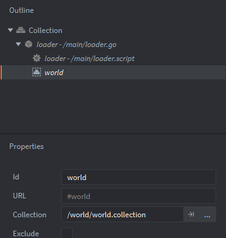
</td>
</tr>
</table>

Loading takes time, so it is a conversation: `load`, and when the proxy answers
`proxy_loaded`, `init` and `enable`.

That is also the whole restart. When the fox dies, the level asks the loader to
`restart`. The loader unloads the level, and when the proxy says it is gone, loads it
again. Every object is back where the collection file says, every counter is zero, and
no script had to remember how to reset itself.

A loaded collection is a world of its own, and three things follow from that:

- **It has its own name in addresses.** The level is `world:`, the loader is in
  `main:`. That is the `main:/loader#loader` of lesson 7.
- **`go.*` does not cross worlds.** A script in the level cannot ask where the loader
  is. Messages cross.
- **Input has to be passed down.** A collection loaded by a proxy only gets input if
  the game object that owns the proxy has input focus. That is the first line of
  `init` above, and forgetting it is why a level sometimes ignores the keyboard.

More: [Collection proxy](https://defold.com/manuals/collection-proxy/).

### 21. Sound

A **sound** component holds a sound file. `world/world.go` has one, `music`, set to
loop, and `world.script` starts it:

```lua
sound.play("#music")
```

Defold plays `.ogg` and `.wav` files. A sound effect for the jump would be one more
component and one more line.

More: [Sound](https://defold.com/manuals/sound/).

### 22. Finding out what went wrong

- **`print` and `pprint`.** Both write to the Console. `pprint` shows what is inside a
  table, which `print` does not. `print(msg.url())` and `pprint(message)` answer most
  questions about messages.
- **Read the error.** A script error stops that call, not the game. The Console gives
  the file and the line, and clicking it opens the file there.
- **Draw the physics.** `debug = 1` under `[physics]`, as in lesson 13. Most collision
  bugs are a shape that is not where you thought, or a group missing from a mask.
- **Hot reload.** With the game running, change a script and press `Ctrl+R`. The game
  takes the new code without restarting. `self` is kept, `init` is not run again.
- **The debugger.** Click beside a line number to set a breakpoint and start the game
  with **Debug ▸ Start/Attach**. The game stops there, and the editor shows the
  locals.

More: [Debugging game logic](https://defold.com/manuals/debugging-game-logic/),
[Hot reload](https://defold.com/manuals/hot-reload/).

## Now change something

Reading a game teaches less than breaking one. These go from five minutes to an
evening, and each one uses a lesson above.

| Do this | You will use |
|---|---|
| Make the fox jump higher. `JUMP_SPEED` is at the top of `player/player.script`. Change it with the game running and press `Ctrl+R` | Hot reload |
| Put a gem inside the first crate: add `pickups/gem.go` to the level and drag it onto `crate` in the Outline | Parents and children, lesson 17 |
| Add a second ladder. Copy `ladder` in the level, move it, and paint ladder tiles behind it in `world.tilemap` | Triggers, the tile map |
| Give the opossum a `speed` property in place of its constant, and make one of the four faster | Script properties |
| Add a `run` action on `Shift` and make the fox faster while it is held | Input |
| Play a sound when a pickup is taken. Free ones are a search away | Components, sound |
| Make a spike that falls when the fox walks under it. The crusher has every piece you need | Collision objects, timers, `go.animate` |
| Let the fox jump once more in the air | The fox's state, in `fixed_update` |
| Add a second level, and have the exit door of the first load it | Collection proxies |

When something does nothing and no error appears, it is nearly always an address or a
name with a typo in it. Print `msg.url()`, read it letter by letter, and see lesson 7.

## Reference

### Where things are

| Path | What is there |
|---|---|
| `game.project` | The settings of the game |
| `main/` | The collection the game starts with. `loader.script` loads the level through a collection proxy, and loads it again on restart |
| `world/world.collection` | The level. Open it to see the tile map, the scenery and every object, enemy and pickup in place |
| `world/world.script` | The flow of the level: counts pickups, feeds the HUD, asks for a restart |
| `world/kinematic.lua` | The movement of kinematic bodies |
| `world/camera.go`, `camera.script` | The camera and the parallax |
| `world/tileset.tilesource`, `tileset_collision.png`, `world.tilemap` | The tiles, their collision shapes and the level made of them |
| `world/props.go`, `props_front.go`, `background/` | The scenery, as sprites |
| `player/` | The fox |
| `enemies/` | The eagle, the frog and the opossum. They share `enemy.lua` |
| `objects/` | Crates, blocks, spikes, platforms, the ladder, the crusher, the crank, the door |
| `pickups/` | Cherries, gems and the sparkle |
| `ui/` | The HUD and its fonts |
| `input/game.input_binding` | The keys |
| `music/` | The music |
| `tests/smoke.lua` | A test that plays the level |
| `docs/images/` | The pictures of this page |

### Who says what to whom

| Message | From | To |
|---|---|---|
| `pickup_added`, `pickup_collected` | A pickup | The level |
| `health_changed`, `player_died`, `level_complete` | The fox | The level |
| `set_health`, `set_count`, `fade_out`, `show_level_complete` | The level | The HUD |
| `faded` | The HUD | The level |
| `restart` | The level | The loader |
| `stomped` | The fox | An enemy |
| `stomp` | The fox | A crate |
| `interact` | The fox | The crank |
| `open` | The crank | Its target, the door |
| `stashed` | A pickup | The crate or door it is a child of |
| `exit_level` | The exit door | The fox |

### The collision groups

| Group | What is in it | Type |
|---|---|---|
| `ground` | Solid tiles, blocks, the crusher | Static, kinematic |
| `oneway` | Tiles and platforms that only hold what lands on them | Static, kinematic |
| `crate` | Crates: solid, and they break | Static |
| `player` | The fox | Kinematic |
| `enemy` | The eagle, the frog, the opossum | Kinematic |
| `hazard` | Spikes, the strip under the falling crusher | Static, kinematic |
| `pickup` | Cherries and gems | Trigger |
| `ladder` | The ladder | Trigger |
| `interact` | The area around the crank | Trigger |
| `sensor` | The exit door, the box under the crusher | Trigger |

## The smoke test

`tests/smoke.lua` plays the whole level and prints `PASS` or `FAIL` for each of its 55
checks. It behaves like an outsider: it presses buttons by posting the input actions to
the fox, and looks only at what any script could see, which is positions, script
properties and whether an object still exists. `world.script` starts it when the engine
is given the setting `test.smoke`.

It needs no window. It runs with `bob.jar`, Defold's command line builder, and
`dmengine_headless`, an engine that draws nothing. They have to be of the same version.
`bob.jar` is on the page of each [Defold release](https://github.com/defold/defold/releases).
That page also gives the `sha1` of the release, and the engine is at
`https://d.defold.com/archive/stable/<sha1>/engine/<platform>/dmengine_headless`, where
the platform is `x86_64-linux`, `x86_64-macos`, `arm64-macos` or `x86_64-win32`. On
Windows the file ends in `.exe`.

```sh
java -jar bob.jar --variant debug build
./dmengine_headless build/default/game.projectc --config=test.smoke=1
```

```
PASS  the player starts on the grass with 3 health
PASS  walks right at 110 px/s
PASS  a jump rises about 48 px
...
55 checks, 0 failed
```

The process exits with 0 if everything passed and with 1 if something failed. It takes
a little over a minute, because the engine keeps real time.

## Gotchas

The short version of the things that cost an afternoon each.

- **`msg.post` is not a call.** The message arrives later. Do not count on its effect
  on the next line.
- **The order of `init` between game objects is not guaranteed**, and neither is the
  order of each update function. Do not write code that needs it.
- **A contact message repeats.** It keeps coming for as long as the shapes overlap, and
  the other side reacts a moment later. The fox remembers which enemies it already
  stomped for that reason.
- **The physics learns where an object is when it steps**, not when the game object
  moves. A ray cast between two steps sees a moving platform where it was.
  `kinematic.lua` has the one place where that matters.
- **Some message names belong to the engine.** Posting `exit` to a game object fails
  with an error about a missing field, because `exit` is the message that quits the
  game. The exit door posts `exit_level`.
- **The functions the engine calls cannot be called by name from inside the script.**
  `on_input` in `player.script` hands over to a local function, so that the test can
  feed it input too.
- **`go.*` only reaches game objects of the collection the script is in.**
- **`go.delete` takes effect at the end of the frame.**
- **Tile shapes are convex**, and computed from the collision image. The 45 degree
  slopes come out exact, the gentler ones within a pixel.
- **The engine allocates up front.** `[sprite] max_count`, `[tilemap] max_tile_count`
  and `[physics] max_collision_object_count` are fixed pools. A level that outgrows one
  logs an error and the rest does not show up. This project raises the first two.
- **All scripts share one Lua.** A variable without `local` is a global for the whole
  game.

## Keep going

- [The Defold manuals](https://defold.com/learn/). Each lesson above links to its own.
- [The examples](https://defold.com/examples/): one small project per feature, each
  running in the browser with its code next to it.
- [The API reference](https://defold.com/ref/stable/go-lua/), with every function of
  every module.
- [The forum](https://forum.defold.com/) and the [Discord](https://defold.com/discord/),
  where questions from beginners are answered by the people who make the engine.
- [The asset portal](https://defold.com/assets/), for libraries made by the community.
- [Defold Tools](https://github.com/Lanterna-Games/defold-tools), if you would like to
  write your Defold code in VS Code and be told about a mistyped address before the
  game is.

This demo has siblings. The same level, with the same art and the same rules, was made
in other engines and frameworks. This is the version that hands every job it can to
the engine. What is left in Lua is the game.

## Licence

The code of the game and the text of this course are yours to take. They are under the
[WTFPL](LICENSE), which lets you do what you want with them, and they come with no
warranty.

The art, the music and the font are not ours to give. Each has the terms its author
gave it, and they are in [Thank you](#thank-you).
